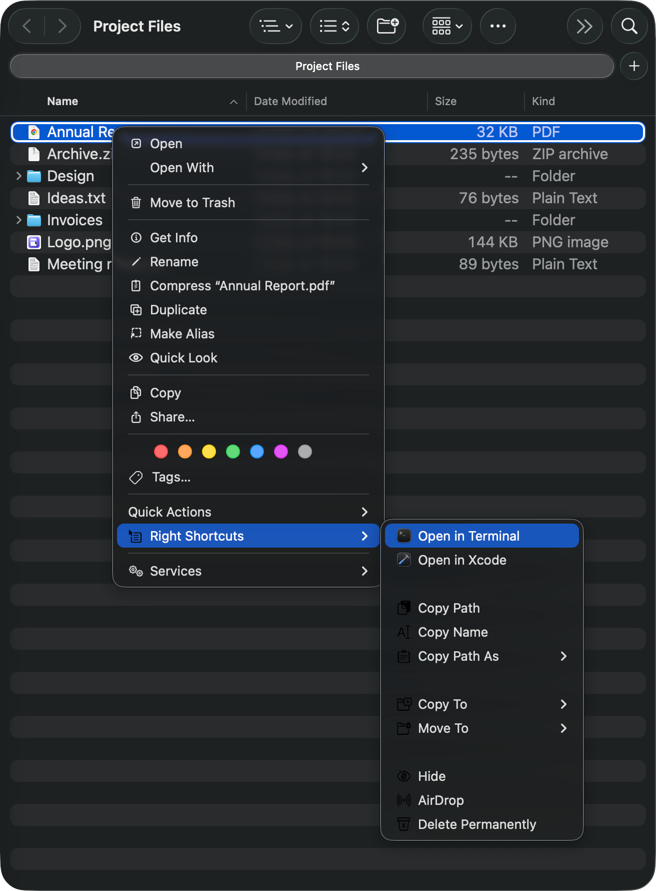
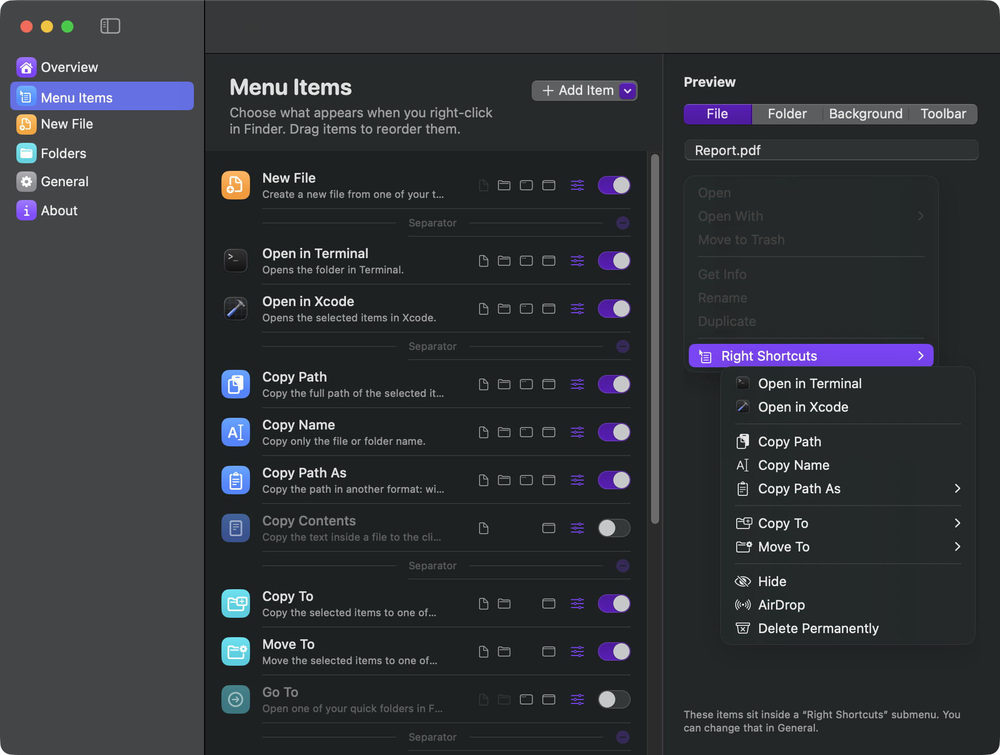
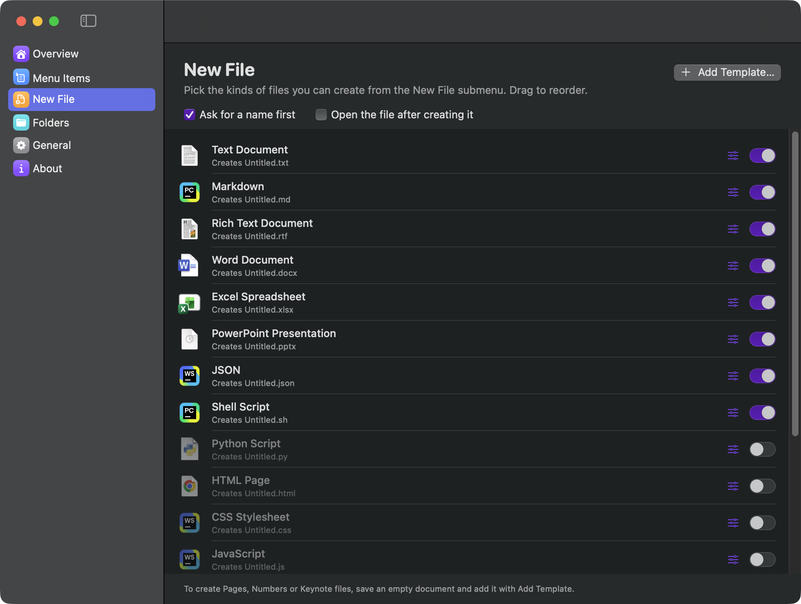
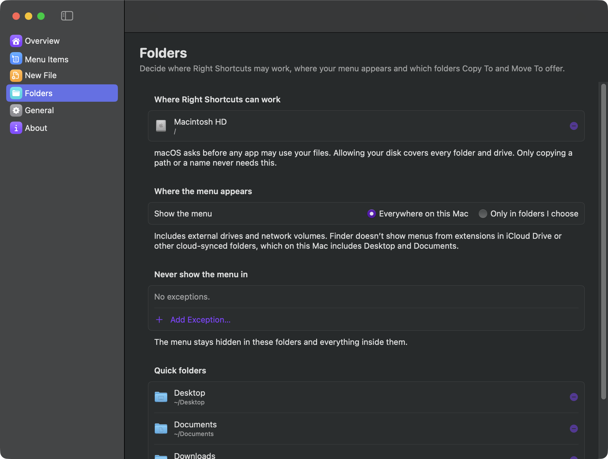

# Right Shortcuts

Right Shortcuts puts the actions you use most into Finder's right-click menu and leaves out the rest. You choose every item, where it appears (files, folders, empty window space, or a toolbar button) and whether the menu works everywhere on your Mac or only in folders you pick.

<p align="center">
  
</p>

## Features

- **New File** from templates: text, Markdown, rich text, Word, Excel, PowerPoint, JSON, shell script, Python, HTML, CSS, JavaScript, TypeScript, Swift, YAML, XML, CSV, or any file you add. It asks for a name first (with the name selected, like Finder's rename) and can open the file afterwards. You can edit what text templates start with.
- **Open in your tools**: Terminal, iTerm, Warp, Ghostty, VS Code, Cursor, Zed, Xcode, JetBrains IDEs or any app. Terminals get the folder; editors get the selected items. You can override this per app.
- **Copy**: full path, name, path with `~`, shell-quoted path, enclosing folder, file URL, or the text inside a file.
- **Copy To, Move To, Go To** your quick folders, or pick a folder. Existing files are never overwritten; clashing names get a number. Large copies show a progress bar and can be stopped; a stopped or failed copy leaves nothing half-done behind.
- **Hide / Unhide**, **Make Executable**, **AirDrop**, **Delete Permanently** (always asks first; Return and Escape both cancel).
- **Custom commands**: your own zsh scripts, run in the background or in a Terminal window, limited to the file types you choose.
- **Per-item control**: turn each item on or off, reorder by dragging, rename it, change its icon, and choose exactly where it shows.
- **Live preview** of the Finder menu for a file, folder, background or toolbar, built with the same logic as the real menu.
- **Works everywhere** (every folder, external and network drives) or only in folders you choose, with exceptions.
- **Starts at login** if you switch it on, lives in the menu bar (optional), with Pause/Resume.
- **Sandboxed**, so it is ready for the Mac App Store. It works on your files only in folders you allowed.
- Native macOS look with light and dark mode, plus Liquid Glass on macOS 26.

## Screenshots

Choose what is in the menu, and see the result in a live preview:



Pick the kinds of files you can create:



Decide where the menu appears and where the app may work:



## Requirements

- macOS 14 Sonoma or later.
- To build and run it yourself: Xcode **or** just the Command Line Tools (`xcode-select --install`), and a code signing identity. A free Apple Development certificate is enough; the build script finds it automatically.
- To publish on the Mac App Store: Xcode and a paid Apple Developer Program membership. See [Publishing on the Mac App Store](#publishing-on-the-mac-app-store).

## Build and install

```sh
make install   # builds, copies to /Applications, enables the Finder extension, launches
```

Other tasks:

```sh
make build      # build/Right Shortcuts.app only
make test       # unit tests (Swift Testing)
make icon       # redraw the app icon after editing scripts/generate-icon.swift
make uninstall  # remove the app; ./scripts/uninstall.sh --purge also deletes settings
make clean
```

Build options: `VERSION=1.2.0 BUILD_NUMBER=42 make build`, `SIGN_IDENTITY="Developer ID Application: …" make build`, `UNIVERSAL=1 make build` (Apple silicon and Intel).

When only the Command Line Tools are installed, the scripts build against the macOS 26 SDK. The newer SDK needs SwiftUI macro plugins that ship only with Xcode.

## First run

A short welcome flow takes you to the Finder extension switch, asks for access to your files, and asks where the menu should appear. After that, right-click anything in Finder and open **Right Shortcuts ▸**. To add a toolbar button, right-click Finder's toolbar, choose **Customize Toolbar…**, and drag Right Shortcuts in.

### Permissions

Right Shortcuts runs in the macOS App Sandbox, so it asks before it can do two things:

- **File access.** Choose your disk once and every action works in every folder and on every drive. You can allow single folders instead, and change this in Settings ▸ Folders. If you skip it, the app asks for the folder the first time an action needs it. Only copying a path or a name never needs it.
- **Command helper.** Custom commands run through a small script that macOS keeps in `~/Library/Application Scripts/com.georgekhananaev.RightShortcuts`. Only you can put a script there, so the app shows that folder and asks before installing it. The script is plain text; open it to see exactly what it does.

### iCloud Drive and other cloud folders

Finder doesn't ask extensions for menu items inside iCloud Drive or other cloud-synced folders. If your Desktop and Documents are stored in iCloud Drive, the menu won't appear there, and no app of this kind can change that. It works in every other folder. Right Shortcuts tells you when this applies to your Mac.

## Custom commands

Scripts run with `zsh -l` in the current folder, so tools from Homebrew work. They run as you, outside the sandbox, once the command helper is installed.

| Variable    | Contains                                          |
|-------------|---------------------------------------------------|
| `"$@"`      | The selected items (or the current folder)        |
| `$RS_DIR`   | The folder you're working in                      |
| `$RS_TARGET`| The folder shown in the Finder window             |
| `$RS_PATHS` | Every selected path, one per line                 |

Use `"$@"` when you need the paths exactly: a file name can itself contain a line break, which `$RS_PATHS` can't tell apart.

Examples:

```sh
shasum -a 256 "$@" | awk '{print $1}' | pbcopy          # copy checksums
for f in "$@"; do sips -s format png "$f" --out "${f%.*}.png"; done   # convert images
git -C "$RS_DIR" status                                  # run in Terminal mode
```

## How it works

```
Finder ──right-click──▶ Finder extension (sandboxed)
                         │ reads settings from the shared App Group container
                         │ builds the menu with MenuResolver
                         └─click──▶ writes the request to Inbox/<id>.json
                                    opens rightshortcuts://perform/<id>
                                                 │
Right Shortcuts app (sandboxed, menu bar) ◀──────┘
  reads the request from the inbox, then does the work:
  files (in folders you allowed), clipboard, apps, prompts
        └─custom commands──▶ helper script, run by macOS outside the sandbox
```

- The **extension** only draws the menu. It never touches your files.
- The **app** does the work. It keeps the folders you allowed as security-scoped bookmarks, so it asks once, not after every restart.
- The app tells the extension what it may do (`access.json`). When a click will need a permission first, the extension brings the app forward so the question appears in front.
- Requests travel as files in the shared container. The URL only wakes the app, so a web page or another app can't trigger actions by opening a link.
- Settings changes reach Finder instantly through a Darwin notification.
- Copies use `copyfile`, which clones instantly on the same disk, reports progress and can be stopped. An item is copied under a hidden temporary name and only then given its real one, with a rename that refuses to replace anything. Quitting stops running copies and removes what was unfinished.
- Nothing is sent anywhere. The app has no network code. Crash reports from macOS stay on your Mac until you choose General ▸ Export Diagnostics.

## Project layout

```
Sources/Core             models, menu logic, shared files, extension-to-app bridge
Sources/Actions          file operations, copy engine, templates, commands, folder permissions
Sources/FinderExtension  the Finder Sync extension
Sources/App              menu bar app: settings window, onboarding, permissions, prompts
Resources                Info.plists, entitlements, bundled files, Office template sources
Tests                    unit tests for Core and Actions
scripts                  build, install, uninstall, test, template packer, icon generator
RightShortcuts.xcodeproj the same sources as an Xcode project, for archiving and the App Store
```

The Xcode project and the build script read the same Info.plists and entitlements and build the same folders, so there is one set of sources to keep.

## Publishing on the Mac App Store

You need the paid Apple Developer Program and Xcode.

1. Open `RightShortcuts.xcodeproj`. In each target's **Signing & Capabilities**, check that your team is selected. Automatic signing creates the certificates and profiles.
2. In [App Store Connect](https://appstoreconnect.apple.com), create the app with the bundle ID `com.georgekhananaev.RightShortcuts`. The Finder extension's ID, `com.georgekhananaev.RightShortcuts.FinderExtension`, is registered automatically.
3. Set the version in the project's build settings (`MARKETING_VERSION`) and raise `CURRENT_PROJECT_VERSION` for every upload.
4. Choose **Product ▸ Archive**, then **Distribute App ▸ App Store Connect**. Xcode validates and uploads the build.
5. In App Store Connect, fill in the listing. For App Privacy, the answer is **Data Not Collected**: the app has no network code. The two addresses the listing asks for:
   - Privacy Policy URL: `https://github.com/georgekhananaev/right-shortcuts/blob/main/PRIVACY.md`
   - Support URL: `https://github.com/georgekhananaev/right-shortcuts/blob/main/SUPPORT.md`

Notes for App Review, worth pasting into the review notes field:

- The app adds items to Finder's right-click menu with a Finder Sync extension. To see it, switch the extension on in System Settings, then right-click a file in any folder that is not in iCloud Drive.
- File actions need folder access. The app asks with the standard open panel, for the folder the action needs, and stores a security-scoped bookmark. Choosing the whole disk is offered because the menu works in every folder, but it is the user's choice and never required.
- `com.apple.security.files.user-selected.executable` is used because New File creates shell scripts that must be runnable, and Copy To must leave copied apps and scripts runnable.
- Custom commands are shell scripts the user writes. They run with `NSUserAppleScriptTask` from the Application Scripts folder. The helper script is installed only after the user confirms in an open panel showing that folder.
- Open at login is off until the user switches it on.

## Continuous integration

`.github/workflows/tests.yml` runs the unit tests on every push and pull request.

## Troubleshooting

- **The menu doesn't appear**: open Right Shortcuts ▸ Overview and check that the Finder extension is on. From Terminal: `pluginkit -m -i com.georgekhananaev.RightShortcuts.FinderExtension` should start with `+`. Running `make install` again re-registers it.
- **The menu is missing only on the Desktop or in Documents**: those folders are in iCloud Drive. See [iCloud Drive and other cloud folders](#icloud-drive-and-other-cloud-folders).
- **An action says it has no permission**: allow the folder, or your whole disk, in Settings ▸ Folders.
- **Something went wrong and you want to report it**: General ▸ Export Diagnostics writes a text file with your settings, recent activity and any crash reports.
- **Logs**: `/usr/bin/log show --last 10m --info --predicate 'subsystem == "com.georgekhananaev.RightShortcuts"'`
- **Settings file**: General ▸ Show Settings File in Finder.

## Privacy and support

- [Privacy policy](PRIVACY.md): Right Shortcuts collects nothing.
- [Support](SUPPORT.md): setup, common questions and how to report a problem.

The app's About pane and the App Store listing link to these two pages, so the files must keep their names and stay on the `main` branch.

## Author

Made by George Khananaev.
